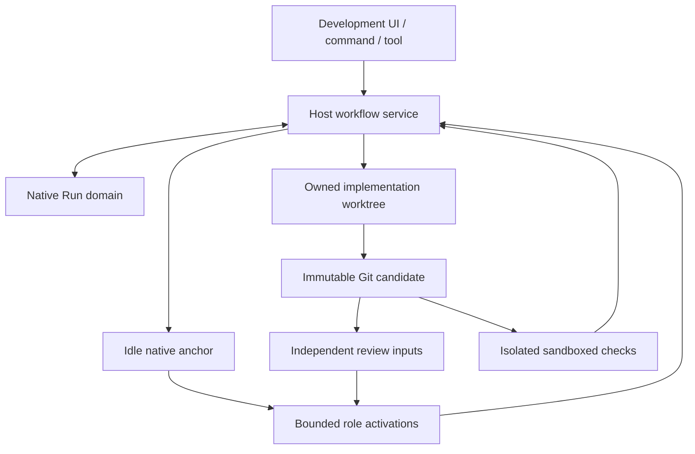

# Native workflow architecture

## Ownership

`WorkflowController` is the scheduler and sole business transition owner. `DevelopmentWorkflowService` is its DSH Host boundary. Native commands, the `sfd_run` tool and the Development panel all use that service; the original conversation provides authorization and model selection but does not own the Run's lifetime.

The anchor is a real live Agent created in the Host's persistent Context. It receives no model-driving prompt. DeepSeek actors use fresh native spawn activations with explicit role presets and `delivery: caller`. GLM actors use external-subagent's ZCode runtime and GPT actors use its Codex runtime; this family transport is frozen in Run policy at creation. External-subagent calls use its published CLI JSON-stdin interface (same fields/projections as the MCP API): spawn, bounded wait, complete paged result, cancel and close. Their final text must parse as the same exact role JSON result and pass Host Zod/semantic admission; a terminal conversation is never completion authority. External admitted model/effort is distinct from runtime-observed identity, which remains UNKNOWN without a verified echo. Native structured output is checked by the DSH schema subset, then the stricter plugin Zod and semantic admission rules.

## Modules

| Module | Responsibility |
| --- | --- |
| `src/core/types.ts`, `contracts.ts`, `schemas.ts` | Persisted business contracts, structural validation, DAG and result invariants |
| `src/core/controller.ts` | Small-step scheduling, durable intents, admission, repairs, controls and recovery |
| `src/workspace/git-workspace.ts` | Complete source trees, worktree ownership, immutable snapshots, real checks and exact-tree delivery |
| `src/workspace/actor-context.ts` | Bounded role presentation with exact immutable evidence files |
| `src/dsh/store.ts` | A single strict native domain containing Run plus its captured owner |
| `src/dsh/actors.ts`, `routing-runner.ts`, `model-routing.ts`, `external-actor.ts`, `checks.ts`, `role-policy.ts` | Frozen model-family routing, native DeepSeek and external GLM/GPT transport, bounded result retrieval and cancellation, deadlines, existing role permissions and Host checks |
| `src/dsh/index.ts`, `remote-contract.ts` | Host service, native entries and Session-resource Remote boundary |
| `src/roles` | Versioned internal workflow knowledge and independent-review projections |
| `src/client` | Read model, owner selection, controls and evidence presentation |

## Persisted authority and concurrency

One domain record is one Run aggregate plus its immutable native owner envelope. `DomainRunStore.update` clones, transforms synchronously, validates and writes within the native table update queue. It never invokes an actor or a filesystem operation inside that transform. No cross-record transaction, cross-process CAS or session-private event API is assumed.

Three counters have different meanings:

- `revision`: any committed aggregate change, useful to observers and optimistic reasoning.
- `inputContractVersion`: a changed goal, Section obligation or semantic execution input.
- `controlEpoch`: authority to dispatch/admit after start, pause, cancellation, revision or recovery.

Parallel A reports bind the same input contract and candidate, not the aggregate revision. An admitted sibling therefore cannot invalidate the other reports. A late old-epoch outcome is historical fact and cannot advance a newly resumed Run.

The controller reserves each actor or operation as an intent, durably marks dispatch started, then performs the side effect. Actual terminal facts and admission are separate. An interrupted `intent` that never crossed the started boundary is different from an unknown started writer. Shutdown only releases physical workspace ownership after active execution has actually converged; an uncooperative provider remains quarantined.

## Review semantics

The plan models observable Features, parent Sections and internal Subsections. Parent Sections form a validated DAG. Each declared Subsection has an owned scope, safe intermediate state, consumer and required scoped oracle. Children execute serially with independently observed R01 checkpoints; the parent R01 reconciliation consumes their actual results. Children have no external dependency identity or separate acceptance/repair allowance.

PLAN A and B independently inspect the current plan in serial order. Code A always includes the complete R01 baseline plus explicitly selected material risk lenses. The controller joins the required current reports before asking for semantic adjudication.

Code B1 receives a complete bounded candidate and requirements, but no earlier A conclusions, repair narratives or implementer self-assessment. Its input is filtered before prompt formatting **and before writing any context artifact**. B2 is the subsequent adjudication of B1 against applicable A/closure evidence on that same candidate; it is not presented as another independent blind reviewer.

Repairs retain the original Section lineage. Current targeted closure can support explicitly reasoned reuse of unaffected A coverage; it cannot impersonate a new full A baseline. SAFE_SIMPLIFICATION is recorded separately with stable SIMP identity; it is not material finding severity and cannot alone demand a repair wave. A batched simplification requires its own preservation-oracle closure. A materially repaired B candidate gets a new full blind B1. Missing coverage triggers bounded additional review/diagnosis; neither failure nor exhausted budget becomes approval. Historical incomplete reports remain history and do not poison a later valid current coverage set.

Every accepted Section is integrated against the actual writer tree before its successors can start. Feature verification checks composed business criteria on the final common candidate. An actually unproven composition risk can request one bounded independent focused review of the specific boundary; this is not another full peer-Section A/B. Evidence IDs must exist, required Host checks must actually pass and all required parent Sections must be integrated. The semantic verifier still owns the interpretation of evidence; structural validity does not prove model correctness.

## Source and evidence

The source checkout and its staging area remain untouched. A temporary alternate index produces a complete tree including current tracked and nonignored untracked files. A dedicated branch/worktree carries development; candidate worktrees are detached, immutable views with captured tree identities.

Checks use another worktree, run in plan order through DSH's ordinary tool policy and sandboxed shell, and record actual exit status and output. A check that changes the source candidate cannot prove the original source. Ignored dependencies/cache are not shared with either the original checkout or the review snapshot.

Large actor evidence is stored verbatim as read-only JSON, with content hashes and an index that the actor can page through using its read tool. Required goal text is retained. Context overflow creates an explicit actionable hold, not a shortened goal or invented completion. The durable ActorTask retains the exact logical input and output schema independently of this presentation.

At the DSH Host entry, the native EXECUTE_WITH_COMMIT workflow always authorizes a commit on its non-main task branch. Internally, `commit: false` is available only as a core/testing contract and delivers an exact verified worktree. `commit: true` creates a Git commit from the accepted immutable tree and moves only the dedicated branch using an expected old head. A durable commit intent and receipt allow a known completed commit to be acknowledged after a crash without generating another one. Required repository hook checks belong in the sandboxed verification plan; plumbing never executes arbitrary repository hooks.

## Permission and observation boundary

The Gateway checks the request's Session resource; the service separately fences Run ownership to that Session. Source selection is canonicalized, including repository-root promotion, so choosing a subdirectory cannot silently grant access to a parent repository outside the original Session scope.

The Host captures the permission preset and effective sandbox mode, and uses native setters when creating runtime identities. One-shot approvals are not turned into persistent grants. Reader presets install read/search tools and enforce read-only mode; implementers have the admitted writer tools. Guards prevent workflow control, generic delegation and unrelated inherited tools inside these roles.

Routes come from the Host configuration captured in Run policy, never arbitrary actor output. Actual `request/header` events provide observed execution identity. Missing observations remain unknown; a silent model substitution is rejected.

## Deliberate limits

This version coordinates one writer per Run in one Host process, with an exclusive physical owner file to prevent a second Host from entering the same worktree. It does not claim durable continuation of vanished JavaScript stacks or exactly-once external processes. Human-confirmed reconciliation handles the remaining side-effect uncertainty. Model reasoning quality and exhaustive coverage remain matters for model evaluation, not facts implied by the state-machine tests.

## Remaining old-Skill semantics and upgrade boundary

PLAN full A/B, bounded own-slot PLAN_DELTA, owner-decision hold and the original PLAN-only silent-A retirement rule are in the Host transition paths. Hard-cap diagnosis allows one nonstructural additional wave or a source-backed structural replan retaining original lineage; a second failure cannot silently create another five-wave lineage. The six Advisor conditions are explicit human holds. After verified actor termination, the Host programmatically exports a local secret-filtered Advisor ZIP, preserves manifest/exclusions/sha256, then calls a bounded read-only notice role for exactly project/feature/reason; Host signs and submits those three text lines through the Feishu bot. A failed or uncertain send is persisted; the ZIP/source never leaves this Host without a separate human act. The original secret filter is best-effort; review ZIP before sharing.

This release uses workflow protocol 1.1.0, policy sfd-native-2, and role protocol sfd-native-roles-2. Previous native Run records must not be silently interpreted as new plans; there is no automatic old-Run migration. The source evidence and active Run must be preserved for manual transition where needed. The local deterministic tests do not prove actual model judgment quality or uninterrupted multi-day real-model execution.
